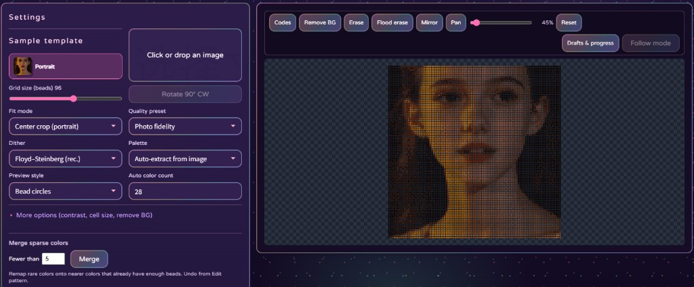

# Fast Bead

**English** | [中文](./README.zh-CN.md)

Free open-source **Perler bead pattern maker**: turn a photo into a printable pattern with color codes and bead counts. Edit colors, use inventory stock, and follow along while placing — **all in the browser, nothing uploads.**

- Live product mirror: [fastgames.cn/tools/perler](https://fastgames.cn/tools/perler/)
- Repository: [github.com/leexiangf/fast_bead](https://github.com/leexiangf/fast_bead)
- WeChat mini program: **李随便拼豆**



## Feature highlights

- **Photo → pattern**: Sample by bead grid; presets for photo fidelity, detail, hand-drawn look, and custom size / color count.
- **Multi-brand palettes**: Built-in MARD, COCO, Manman, Panpan, Mixiaowo, Artkal, Perler, Hama, and more — patterns ship with real color codes.
- **FS v2 / hand-like pipelines**: Quantize and dither paths tuned for illustration and photos, cleaner blocks with fewer muddy edges.
- **Background remove & edit**: One-tap outer background cut (tolerance); paint, bucket, recolor, eraser, region erase, with undo.
- **Sparse color merge**: Merge speckles by similarity threshold for cleaner boards and simpler shopping lists.
- **Inventory colors**: Mark beads you already own; optionally rematch using stock-only colors.
- **Follow / craft mode (highlight)**: Place by color or by row; “Next bead” advances cell-by-cell with saved progress, color focus, rulers, and local drafts you can resume later.
- **Counts & structure tips**: Per-color bead totals and pack estimates; structure panel for connectivity checks.
- **Print & export**: PNG patterns, code-labeled sheets, CSV lists; optional 29×29 / 58×58 board tiling and peg-pitch hints.
- **Browser-local & open source**: All conversion stays on your device — no image upload. MIT license, easy to self-host.

## Quick start

```bash
git clone https://github.com/leexiangf/fast_bead.git
cd fast_bead
npx --yes serve -l 5173 .
```

Open `http://localhost:5173`.

Or open `index.html` via any static file server (required for ES-less relative loads / some browsers’ `file://` limits).

## Layout

```
fast_bead/
  index.html          # app shell
  css/                # UI
  js/                 # palettes, quantize, craft, i18n
  templates/          # sample photo
  docs/               # algorithm notes + screenshots
```

Hub-only pieces (analytics Worker, paint handoff, Beadants level export) are stubbed or removed so the package runs alone.

## License

MIT © leexiangf — see [LICENSE](./LICENSE).

## Contributing

Issues and PRs welcome. Prefer small, focused changes (palette data, bug fixes, docs). Please do not submit copies of AGPL-licensed third-party code.
